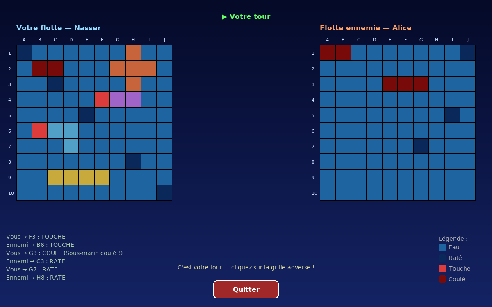
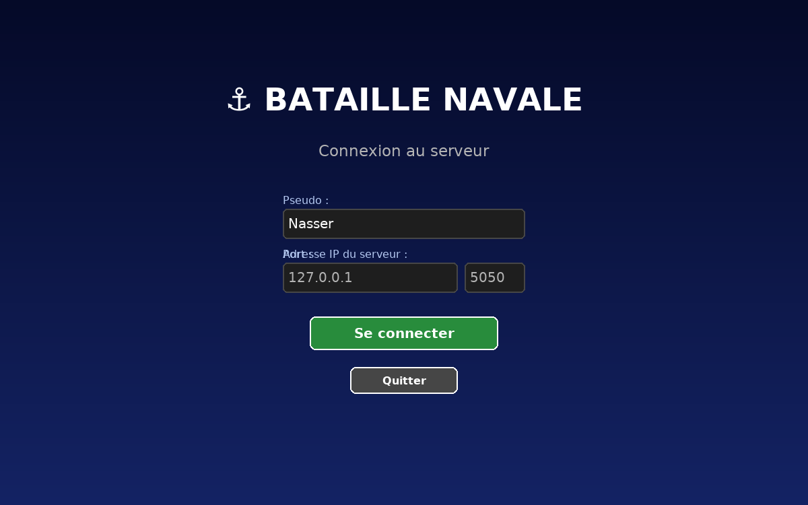
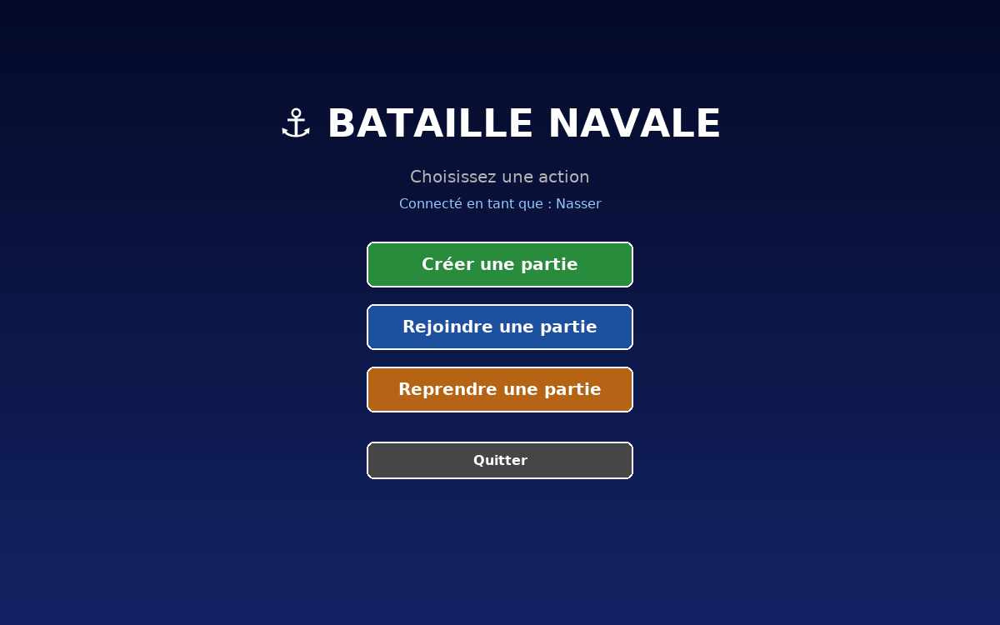
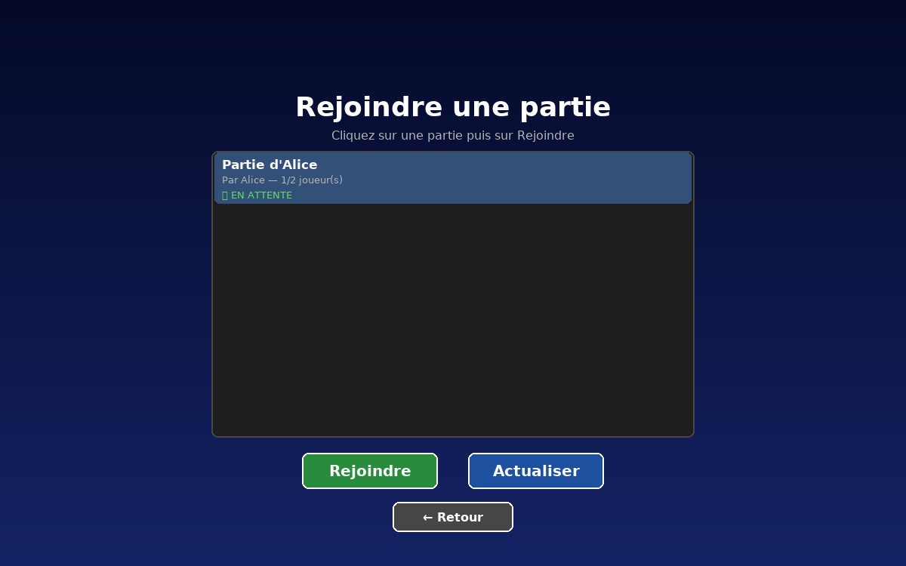
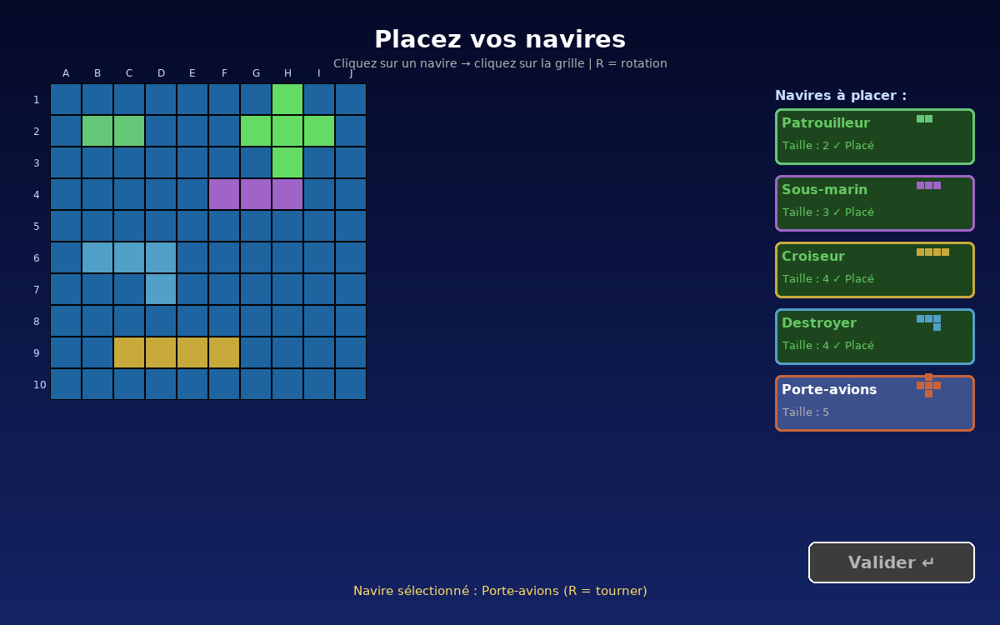
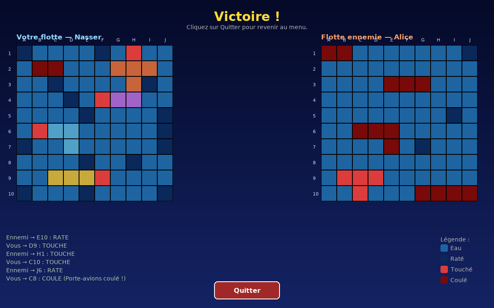
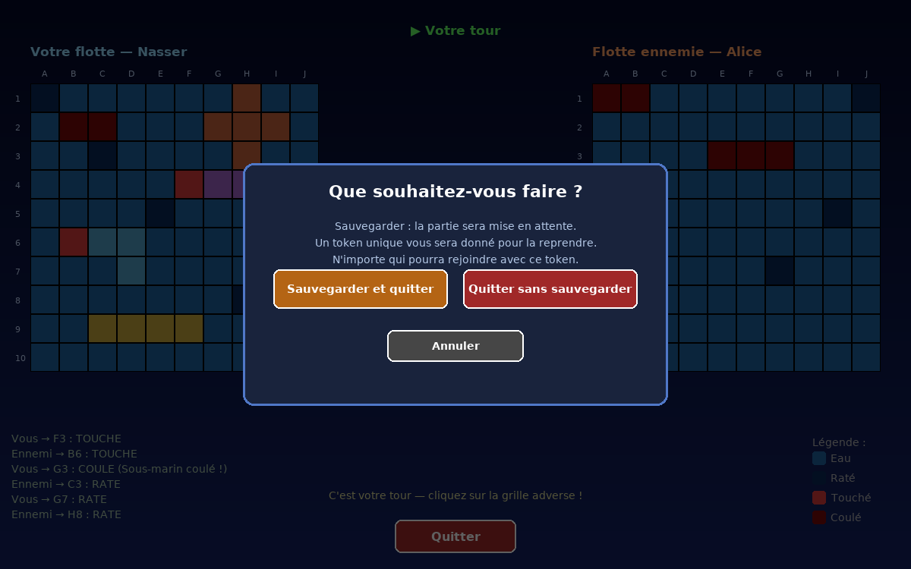

# ⚓ Bataille Navale — jeu en réseau (Python · Pygame · sockets TCP)

Jeu de bataille navale **à deux joueurs en réseau** : un serveur Python gère les parties, chaque joueur lance un client avec une interface graphique Pygame.



## Fonctionnalités

- 🌐 **Multijoueur** en local ou sur un réseau local (LAN), via sockets TCP et messages JSON
- 🎮 **Créer, rejoindre ou reprendre** une partie depuis le menu
- 🚢 **5 navires de formes différentes** (droits, en L, en T), avec rotation
- 💾 **Sauvegarde en cours de partie** : un token permet de la reprendre plus tard
- ⚡ **Serveur lancé automatiquement** quand on joue en local

## Installation

Il faut **Python 3.8 ou plus**.

```bash
git clone https://github.com/nassersalimou/bataille-navale
cd bataille-navale
python -m venv .venv
```

Activer l'environnement virtuel :

| Système | Commande |
|---|---|
| Windows (PowerShell) | `.\.venv\Scripts\Activate.ps1` |
| Windows (CMD) | `.\.venv\Scripts\activate.bat` |
| Linux / macOS | `source .venv/bin/activate` |

Puis installer Pygame :

```bash
pip install -r requirements.txt
```

## Lancer une partie

### Sur un seul PC (le plus simple)

Ouvrez **deux terminaux** et lancez dans chacun :

```bash
python bataille_navale/main.py
```

Le premier client démarre le serveur tout seul en arrière-plan. Le second s'y connecte.

### Sur deux PC du même réseau

1. Sur le PC qui héberge, lancez le serveur en écoutant sur tout le réseau :
   ```bash
   python bataille_navale/main.py --serveur-seul --ip 0.0.0.0
   ```
2. Sur chaque PC joueur, lancez le client avec l'adresse IP de l'hôte :
   ```bash
   python bataille_navale/main.py --ip 192.168.1.5
   ```

### Options

| Option | Rôle | Défaut |
|---|---|---|
| `--pseudo Alice` | Pré-remplit le pseudo | vide |
| `--ip` | Adresse du serveur | `127.0.0.1` |
| `--port` | Port du serveur | `5050` |
| `--serveur-seul` | Lance uniquement le serveur, sans interface | — |

## Comment jouer

### 1. Se connecter

Entrez votre pseudo, puis l'adresse IP et le port du serveur (laissez les valeurs par défaut pour jouer en local).



### 2. Créer ou rejoindre une partie

Un joueur **crée** une partie en lui donnant un nom. L'autre clique sur **Rejoindre**, sélectionne la partie dans la liste, puis valide.

| Menu principal | Liste des parties |
|---|---|
|  |  |

### 3. Placer ses navires

Cliquez sur un navire à droite, puis sur la grille pour le poser. L'aperçu est **vert** si la place est libre, **rouge** sinon.

- **R** : tourner le navire
- **Entrée** ou **Valider** : confirmer quand les 5 navires sont posés



| Navire | Taille | Forme |
|---|---|---|
| Patrouilleur | 2 | droit |
| Sous-marin | 3 | droit |
| Croiseur | 4 | droit |
| Destroyer | 4 | en L |
| Porte-avions | 5 | en T |

### 4. Tirer

Quand c'est votre tour, cliquez sur une case de la **grille ennemie** (à droite). Votre flotte reste visible à gauche.

| Couleur | Signification |
|---|---|
| Bleu | Eau, pas encore visée |
| Bleu foncé | Raté |
| Rouge | Touché |
| Rouge sombre | Coulé |

L'historique des derniers tirs s'affiche en bas à gauche. Le premier qui coule toute la flotte adverse gagne.



### 5. Sauvegarder et reprendre

En cours de partie, **Quitter** propose de **sauvegarder**. Le jeu vous donne alors un **token**. Pour continuer plus tard, allez dans **Reprendre une partie** et entrez ce token.



## Structure du projet

```
bataille_navale/
├── main.py               # point d'entrée (client + lancement auto du serveur)
├── constantes.py         # tailles, couleurs, navires, réseau
├── protocole.py          # messages JSON échangés client ⇄ serveur
├── grille.py, case.py, navire.py
├── client/
│   ├── app_client.py     # boucle Pygame et navigation entre les écrans
│   ├── client_reseau.py  # connexion TCP (thread de réception)
│   ├── ecrans/           # connexion, menu, création, placement, partie…
│   └── ui/widgets.py     # boutons, champs texte, liste de parties
└── server/
    ├── serveur.py        # serveur TCP multi-clients
    ├── models/partie.py  # règles du jeu (tours, tirs, victoire)
    └── persistence/      # sauvegarde des parties en JSON
```

## Sécurité

- Les parties sauvegardées sont stockées en local au format JSON.
- Le serveur écoute par défaut sur `127.0.0.1` (votre PC uniquement). Ne l'exposez pas sur Internet sans audit.

## Licence

Licence MIT.
